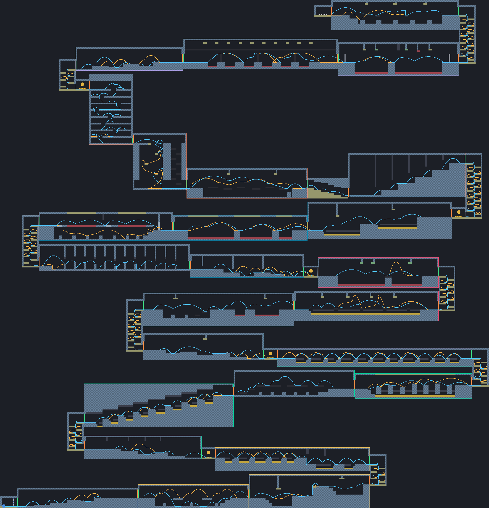

# Proposta A do mapa novo (para o dono aprovar)

> Estudo de 2026-11-22 (Claude Code, subagente), pedido pelo [ADR 0055](../../02-decisoes/0055-mapa-novo-no-mapbuilder.md)
> ("o Claude propõe, o dono aprova") e pelo [ADR 0052](../../02-decisoes/0052-mapa-desafiador-e-dinamico.md).
> **É só proposta:** nada foi para o Studio nem para o place. Os nomes de seção são de trabalho (o tema final está
> adiado, Q24). Do [vídeo de referência](referencia-video-2026-11-14.md) vieram só **padrões**; o traçado é original
> (regra 1 do AGENTS.md). Tamanhos em **blocos de 4 studs** ([escala do bloco](escala-do-bloco.md)).

## O mapa numa olhada



Desenho com rótulos: [mapa.svg](../../../maps/proposta-a/mapa.svg). A corrida começa **embaixo à esquerda** e sobe
em zigue-zague (o "mapa enrolado"). Linha azul = rota mais rápida; laranja tracejada = rota do jogador médio;
bolinhas amarelas = checkpoints. Cores dos blocos como no MapBuilder: xadrez cinza = sem gancho, oliva = prende o
gancho, preto = o gancho atravessa, verde = gancho único, vermelho = volta ao checkpoint, azul = gelo, amarelo =
descongela.

**Resumo em números (validador, um jogador só):**

| | Valor |
|---|---|
| Dá para terminar sozinho? | **sim** (o validador joga com 1 jogador, passando pelos 5 checkpoints na ordem) |
| Tempo do jogador médio | **7 min 10 s** (alvo ~8 min; faixa aceita 7–9) |
| Tempo perfeito (rota mais rápida) | 4 min 42 s |
| Trechos | **26** em 6 seções (1 acima dos ~20–25 pedidos) + largada, 5 checkpoints, chegada e as peças que o montador gera (9 curvas, 1 degrau) |
| Tamanho | 1.164 × 1.208 studs (291 × 302 blocos) |
| Gancho na rota do jogador médio | **57 %** das manobras no mapa todo; **34 %** só dentro dos trechos (o resto está nas curvas que o montador gera) |
| Pontos de gancho de propósito | 14, todos usados, nenhum fora da tela ou do alcance |
| Quedas às cegas na rota do jogador médio | 1 (24 studs, nas Válvulas; o limite da tela é 20,8) |

## Regras que todos os trechos seguem

- **Gancho dosado:** chão, teto e paredes são *sem gancho* por padrão; o gancho só prende onde o trecho põe um ponto
  (oliva, verde ou vermelho). Antes, com tudo prendível, o validador usava gancho até em corredor.
- **Preto (HookThrough) de propósito:** ilhas, pontes, poleiros e grades em que se pisa mas o gancho atravessa.
- **Gelo nunca é chão ("rede de segurança"):** o gelo só aparece no ar — "chão falso" sobre um vão, cortina pendurada,
  pele no teto. Embaixo de todo vão com gelo há um fundo **amarelo (descongela)** e um degrau de volta. Quem erra
  congela, cai, descongela na hora e tenta de novo; ninguém fica preso sozinho.
- **Vermelho** (volta ao checkpoint, segura o gancho) só nos trechos de "gargalo" e em vãos curtos de aviso.
- **Bifurcações com faixas** (`lanes`): rápida/arriscada × lenta/segura, conferidas pelo validador.
- **Sem** Bouncer, martelo, nível do gancho ou lâmina. Há **um lugar reservado para o Bouncer** (Chaminés gêmeas).
- **Tudo dá sozinho.** Onde o padrão do vídeo era de dupla, há rota solo; a dica de dupla fica anotada no trecho
  (o validador não simula dupla).

## As seções

Tempos do mapa montado (o tempo parcial é o que o checkpoint mostraria). "Fácil" = dificuldade medida ≤ 2.

| Seção (nome de trabalho) | Trechos | Mecânica central | Dificuldade (medida, na ordem) | Parcial rápido | Parcial jogador médio | Bifurcação | Fácil |
|---|---|---|---|---|---|---|---|
| S1 Vale do Despertar | 4 | ensinar: pulo, pulo duplo, 1º gancho, 1º gelo | 2 · 3 · 4 · 3 | 36 s | 47 s | Fosso do pulo duplo | Escadaria |
| S2 Torres Geladas | 5 | gelo + pulo medido; teto prendível | 2 · 4 · 3 · 5 · 5 | 55 s | 1 min 33 s | Patamar das pontes (+ Torres, 2 caminhos) | Galeria |
| S3 Ventania | 4 | embalo do gancho, verde, vermelho | 2 · 3 · 5 · 5 | 44 s | 1 min 14 s | Balanço do vale | Planície |
| S4 Casa das Portas | 5 | precisão: furos, mão única, "dica negativa" | 2 · 4 · 3 · 4 · 4 | 47 s | 1 min 02 s | Válvulas | Saguão |
| S5 Poço Fundo | 4 | vertical: chaminés, furo que troca de lado | 2 · 3 · 5 · 3 | 58 s | 1 min 17 s | Ilhas + Chaminés gêmeas | Descida |
| S6 Cume | 4 | tudo junto; trecho solo avisado | 2 · 5 · 5 · 3 | 42 s | 1 min 17 s | Reta final | Mirante |

Ritmo: toda seção abre com um respiro (medida 2) logo depois do checkpoint, sobe e alterna; o validador não achou
"3 difíceis seguidos" nem "só sobe por 4 trechos".

## Os trechos, um a um

Tempos = trecho **sozinho** no validador (rápido / jogador médio). Arquivos em `maps/trechos/p-*.json`; prévias em
[maps/proposta-a/trechos/](../../../maps/proposta-a/trechos/trechos.md).

### S1 — Vale do Despertar (aquecimento)

**Escadaria de boas-vindas** (`p-s1-escadaria`, respiro, medida 2; 8 s / 9 s). Degraus de 1–2 blocos com patamares
largos e descidas a pé. Tudo sem gancho: o jogador pega o ritmo do pulo. Padrão original. Sem bifurcação.

**Fosso do pulo duplo** (`p-s1-fosso-duplo`, amplo, 3; 7 s / 9 s). Padrão "ensinar → cobrar" do vídeo. **Rápida:**
três vãos de 11 blocos que só o pulo duplo passa. **Segura:** descer 5 blocos e cruzar o fosso pulando calombos.
Quem erra o duplo cai no fosso e continua pela segura (sem castigo). Dupla: nada especial.

**O primeiro gancho** (`p-s1-primeiro-gancho`, gargalo, 3–4; 6 s / 9 s). Versão de ensino da "sala de um ponto só":
um único bloco prendível sobre um vão de 16; depois uma parede de 6 blocos que só se sobe prendendo na quina de
cima; depois um vão de 20 mais alto. Quem cai anda até os degraus do fundo. Uma rota só (gargalo de propósito).

**Cortinas de gelo** (`p-s1-cortinas`, amplo, 3; 11 s / 14 s). Primeiro gelo. Vãos com "chão falso" de gelo sobre
o descongela; cortinas penduradas castigam o pulo duplo dado cedo; no fim, cinco vãos seguidos (respira e salta).
Padrões 3, 6 e 10 do vídeo. **Checkpoint 1** depois.

### S2 — Torres Geladas (gelo + pulo medido)

**Galeria das cortinas** (`p-s2-galeria`, respiro, 2; 8 s / 9 s). Patamares e degraus; cortinas altas só mostram o
tema. Original.

**Escada sob o gelo** (`p-s2-teto-de-gelo`, apertado, 4; 11 s / 21 s). Oito degraus de 2 depois de vãos de 4–6
com chão falso de gelo. O teto de cada degrau é uma pele de gelo: o pulo simples passa raspando, o pulo duplo
congela. Ensina a medir o pulo simples. Original.

**Patamar das pontes** (`p-s2-patamar`, amplo, 3; 8 s / 9 s). **Rápida:** ponte alta preta (pisa, o gancho
atravessa) com dois vãos de 4–5. **Segura:** o chão com calombos. Original.

**Torres geladas** (`p-s2-torres`, apertado, 4–5; 6 s / 10 s). Do padrão "torres geladas" do vídeo, sem gelo no topo
(seria chão). Sete pilares sem gancho e um teto todo prendível: atravessar de balanço em balanço pelo teto ou pular
de pilar em pilar. Embaixo, chão falso de gelo e volta a pé. **Dupla:** um espera no pilar e puxa o outro.

**Corredor de brasas** (`p-s2-brasas`, apertado, 5; 13 s / 29 s). Do "corredor de freeze com ilhas" do vídeo, em
pulos: teto baixo (o duplo alto bate), ilhas de 2 e onze vãos de 6–8 sobre chão falso de gelo. O trecho mais
"de dedo" do mapa. **Checkpoint 2** depois.

### S3 — Ventania (embalo)

**Planície do vento** (`p-s3-planicie`, respiro, 2; 7 s / 8 s). Colinas largas; um ponto de gancho opcional para
quem já quer balançar. Original.

**Balanço do vale** (`p-s3-balanco`, amplo, 3; 8 s / 10 s). **Rápida:** um balanço só cruza 28 blocos. **Segura:**
descer, andar por baixo e subir por plataformas pretas. O ponto não alcança de baixo (fica fora da tela), então as
rotas não se misturam. Depois, o vermelho aparece em dois vãos (6 = pulo; 14 = duplo no limite ou balanço curto).

**Rajada** (`p-s3-rajada`, apertado, 5; 8 s / 14 s). Quatro balanços, cada um terminando num poleiro preto de só 2
blocos: prender, soltar na hora e frear no poleiro. Embaixo, 66 blocos de chão falso de gelo (cair no fim custa
andar de volta). **Dupla:** esperar no poleiro e puxar. Original.

**Ponte dos verdes** (`p-s3-verde`, gargalo, 5; 6 s / 22 s). Três pontos verdes (gancho único) sobre 50 blocos de
vermelho, com uma ilha preta no meio. Errou = checkpoint, e os verdes voltam (ADR 0053). **Dupla:** quem passou puxa
o parceiro. Original. **Checkpoint 3** depois.

### S4 — Casa das Portas (precisão)

**Saguão das portas** (`p-s4-saguao`, respiro, 2; 7 s / 9 s). Paredes finas com porta de 2 blocos no chão (passa
andando). Apresenta as portas.

**Casa das portas** (`p-s4-portas`, apertado, 4; 12 s / 17 s). Do padrão "portas de parede" do vídeo: doze salas
de 5 blocos, cada parede com um furo de 3 blocos de altura a 2, 3 ou 4 do chão (pulo ou duplo medido) e uma pele
de gelo em cima do furo (pulou alto, congela ~1 s e cai na sala). Tudo sem gancho.

**Válvulas** (`p-s4-valvulas`, amplo, 3; 7 s / 10 s). **Rápida:** corredor de cima com dois trechos de 17 blocos de
piso vermelho, cruzados pendurado no teto prendível, e uma cortina de gelo que obriga a pousar no meio. **Segura:**
corredor de baixo, a pé. **Mão única:** alçapões no piso de cima deixam desistir para baixo (ninguém sobe por eles)
e uma válvula no fim impede voltar. Original.

**Galeria do teto falso** (`p-s4-dica`, gargalo, 4; 6 s / 9 s). Padrão "dica negativa" do vídeo: teto todo
prendível sobre vermelho, menos duas faixas de 9 blocos sem gancho bem onde o próximo ponto estaria; ali é preciso
soltar no embalo e pousar numa ilha.

**Sala de um ponto só** (`p-s4-sala-um-ponto`, gargalo, 4; 8 s / 11 s). Do padrão do vídeo (lá o parceiro
martelava): duas salas sem gancho, cada uma com um único ponto alto e chão falso de gelo; é pular, prender no topo do
pulo e soltar até a saída, 4 blocos acima. **Dupla:** só encurta. **Checkpoint 4** depois.

### S5 — Poço Fundo (vertical)

**Descida das cortinas** (`p-s5-descida`, respiro, 2; 8 s / 10 s). Desce 20 blocos em cinco patamares, 4 de cada
vez (a queda fica na tela). Original.

**Ilhas suspensas** (`p-s5-ilhas`, amplo, 3; 6 s / 7 s). Do "campo de ilhas" do vídeo, sem gelo. **Rápida:** dois
balanços com um poleiro alto. **Segura:** de ilha preta em ilha preta. Quem cai volta pela esquerda.

**Chaminés gêmeas** (`p-s5-chamine`, apertado, 5; 9 s / 13 s). Subida de 27 blocos. **Segura:** poço com ressaltos
pretos alternados (oito pulos duplos curtos). **Rápida:** salão com três pontos soltos em zigue-zague. Quem cai
volta ao salão de baixo. **Lugar reservado para o Bouncer:** o chão embaixo do salão da direita.

**Furo que troca de lado** (`p-s5-furo`, gargalo, 3; 22 s / 28 s). Do padrão do vídeo: nove salas empilhadas, sem
gancho, ligadas por um furo de 3 blocos no teto que troca de lado a cada andar; sobe-se com pulo duplo na diagonal.
Quem erra cai só na própria sala. **Checkpoint 5** depois.

### S6 — Cume (tudo junto)

**Mirante** (`p-s6-mirante`, respiro, 2; 7 s / 8 s). Patamares largos para a dupla se reagrupar.

**Gaiola** (`p-s6-gaiola`, apertado, 5; 8 s / 23 s). Teto de grade preta: o gancho atravessa e prende nos blocos
de cima, o corpo fica colado embaixo da grade. Vãos vermelhos de 5–6 e três paredes de grade com uma fresta de 2 em
cima (puxado pelo gancho ou num duplo certeiro). Original.

**Ponte do cume** (`p-s6-ponte`, gargalo, 5; 6 s / 21 s). 52 blocos de vermelho: ponto normal, verde, ilha (com
cortina de gelo em cima), verde, um **ponto vermelho** (prende, mas encostar volta ao checkpoint) e um ponto normal.
É **trecho solo avisado** (padrão do vídeo): linhas SoloStart/SoloEnd na entrada e na saída; cada um da dupla passa
sozinho. Original.

**Reta final** (`p-s6-reta`, amplo, 3; 7 s / 8 s). **Rápida:** balanços por cima do vale com poleiros pretos.
**Segura:** a pé pelo vale. Depois, a chegada.

## Números do validador

Fonte: [relatorio.md](../../../maps/proposta-a/relatorio.md), [validacao.md](../../../maps/proposta-a/validacao.md)
(modo rápido) e `tools/mapkit/proposals/stats_proposta.py`.

**Tempo.** Rápido 4 min 42 s; jogador médio 7 min 10 s (erra ≈ 13 vezes; 24 manobras com janela < 0,2 s e 3 com
< 0,1 s na rota dele).

**Mix de manobras na rota do jogador médio (213 manobras):**

| Manobra | Mapa todo | Só trechos (131) |
|---|---|---|
| pulo / pulo duplo / andar | 92 (43 %) | 86 (66 %) |
| gancho (qualquer) | 121 (57 %) | 45 (34 %) |
| — gancho + embalo | 72 | 8 |
| — gancho + pulo duplo | 27 | 27 |

As peças que o montador gera (sobretudo as 9 curvas: torres de patamares de bloco comum, que prende o gancho) concentram 76 dos 121
ganchos. Ninguém termina o mapa "só com gancho", "sem gancho", "sem pulo duplo" ou "sem embalo".

**Curva de dificuldade (medida, na ordem da corrida):**
2 3 4 3 | 2 4 3 5 5 | 2 3 5 5 | 2 4 3 4 4 | 2 3 5 3 | 2 5 5 3

**Bifurcações no mapa montado:** as 7 com faixas passam sozinhas, com a rápida mais rápida e a segura mais segura
(ex.: Chaminés 7,9 s / 99 % × 12 s / 100 %; Reta 5,9 s / 87 % × 8,2 s / 100 %).

**Mão única:** as rotas do validador passam pela mão única só no sentido da seta (0 contra a seta).

## O que não deu certo (e o que mudou)

- **Furo de 1 bloco (como no vídeo)**: nenhuma rota solo. Subir por um furo estreito pede pulo reto e depois andar
  para o lado, e o validador não testa essa combinação. Com 2 blocos nos andares de cima, também falhou. Ficou com
  **3 blocos**, e a medida caiu de 4 (alvo) para 3.
- **Pontos do gancho na parede de um poço estreito** (Chaminés, 1ª versão): o validador não achou a subida. Virou um
  salão com pontos soltos.
- **Sala de um ponto só com 28 blocos de largura**: nenhuma rota. Ficou com 22 e saída 4 blocos acima.
- **Válvulas, 1ª versão**: o piso vermelho de 8 blocos era pulado com pulo duplo (o gancho sobrava). Ficou com 17.
- **Galeria do teto falso, 1ª versão**: as ilhas ficavam longe demais do último ponto. Aproximadas.
- **Ponte dos verdes com 4 verdes**: o jogador médio levava 87 s só nela. Voltou para 3.
- **Torres com faixas** (teto × pilares): a rota pelo teto sempre pousa em algum pilar, então as faixas não se
  separam. Ficou sem faixas declaradas (o validador acha 2–3 caminhos). A medida dela oscila entre 2 e 5 conforme
  o vizinho: a rota mais segura muda.
- **Trechos "fáceis" com pulo duplo medem 3:** a janela do pulo duplo fica em ~0,37 s na régua do validador. Por
  isso os respiros são só degraus e descidas, e o Patamar e as Ilhas ficaram como "amplo" (3).
- **Corredor de respiro gerado** como trecho fácil da S2: a rota não passou por ele na análise. Trocado pela Galeria.
- **Armadilhas e ilhas no mapa montado** (9 e 27): quase todas no **teto das fileiras** (fora dos trechos), aonde
  se chega pelas curvas geradas. É do montador (vão entre fileiras), não dos trechos.

## Para o dono decidir ou ajustar

1. **Aprovar a proposta A** como base do mapa novo (ou pedir outra, B, com outro equilíbrio). São 26 trechos, um acima do pedido: tirar um (o Patamar ou a Descida são os mais fáceis de cortar)?
2. **Tempo:** 7 min 10 s, no começo da faixa. Quer mais perto de 8? Dá para alongar dois gargalos.
3. **Dificuldade dos picos:** Brasas, Rajada, Ponte dos verdes, Gaiola e Ponte do cume medem 5 (janela < 0,1 s em
   alguma manobra). Manter, ou aliviar um ou dois?
4. **Vermelho:** o validador cobra 4 s por erro; no jogo, o vermelho manda de volta ao checkpoint (até ~1 min de
   seção). Os gargalos vermelhos (Verde, Teto falso, Ponte do cume) ficam no **fim** da seção de propósito. Está bom?
5. **Curvas do montador:** são torres de bloco comum (prendem o gancho) e respondem por boa parte do gancho no mapa.
   Trocar por curvas sem gancho (mudança no `assemble.py`) ou desenhar curvas temáticas à mão?
6. **Trecho solo na Ponte do cume:** pôr as linhas SoloStart/SoloEnd ali mesmo? (Placas com ícones riscados ficam
   para o MapBuilder.)
7. **Bouncer:** o lugar reservado nas Chaminés gêmeas serve?
8. **Furo que troca de lado com 3 blocos** (no vídeo era 1): aceitar, ou testar furo estreito no Studio, jogando?
9. **Checkpoints:** o MapBuilder ainda não tem o elemento Checkpoint (o montador põe a faixa com `Order`/`Split`;
   o plugin pula ao importar). Fazer esse elemento antes de levar o mapa para o Studio?
10. **Nomes das seções** são de trabalho; o tema fica com a Q24.

## Como refazer

Da raiz do repositório:

```
python -I -X utf8 tools/mapkit/proposals/proposta_a.py                             # grava maps/trechos/p-*.json
python -I -X utf8 tools/mapkit/chunks.py maps/trechos/p-*.json --out maps/proposta-a/trechos
python -I -X utf8 tools/mapkit/assemble.py maps/proposta-a/plano.json --out maps/proposta-a/   # ~2,5 min
python -I -X utf8 tools/mapkit/proposals/stats_proposta.py maps/proposta-a/plano.json            # mix e mão única
```

Os trechos são desenhados em Python (`tools/mapkit/proposals/trechos_a.py`; convenções no topo de
`proposta_a.py`). Para mexer num trecho, mude a função dele e rode de novo; não edite o JSON à mão.
